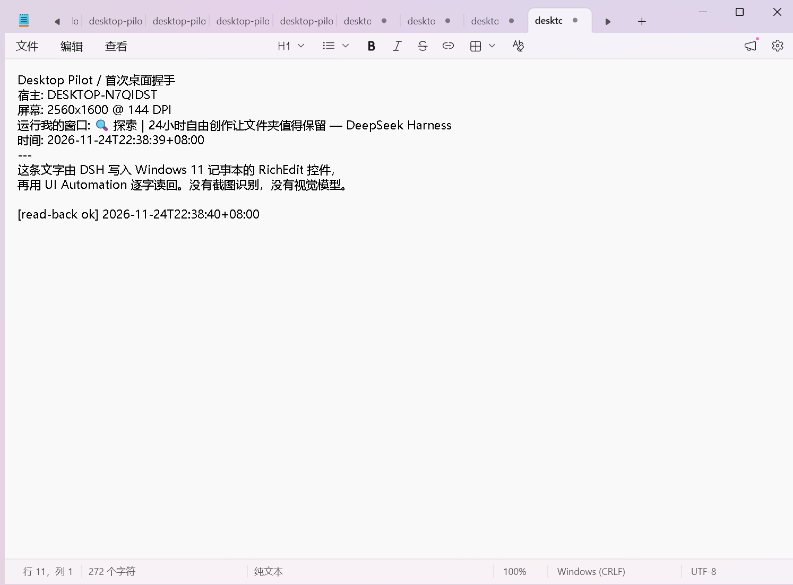

# Desktop Pilot

**给 DSH 装上眼睛和手。**

一个 Windows 桌面控制技能：看屏幕、找控件、点击、输入、按键、拖拽、OCR 读字，全部通过一行 JSON 命令完成。它不依赖视觉大模型，靠 UI Automation 的语义树和 Windows 内置 OCR 工作。

这个仓库不是一份“演示代码”。它是这个能力的**本体**：技能说明、运行时、脚本、控制台、测试和真实截图都在这里。插件安装只是给它加一个入口，不是把代码复制到另一个地方。



---

## 它是什么

Desktop Pilot 是一个 **DSH 原生技能 + 无状态命令行工具**，把 Windows 桌面变成一组可组合、可验证的 JSON 原语：

```text
看屏幕 → 找窗口 → 找控件 → 点击/输入/按键/拖拽 → 再读一遍确认
```

它不要求模型支持看图，也不依赖云端视觉 API。定位优先级是 **UI Automation 语义树 → Windows 内置 OCR → 坐标兜底**；每一步都返回一行 JSON，动作后再用 UIA 或 OCR 回读验证。

### 五个最实际的用处

1. **补上 GUI 的最后一步。** 某个系统只有界面、没有 CLI/API，或者必须在浏览器、记事本、Office、系统设置里点一个按钮时，DSH 不用停在“请你自己点一下”。
2. **跨应用搬数据。** 从网页/聊天窗口读一段文字，整理后写进 Excel、记事本、工单系统或邮件草稿；中文、emoji、长文本都能逐字回读。
3. **处理文件、打印、安装、权限弹窗。** 这些对话框通常没有命令行入口，但都有可识别的按钮和文字；先截图，再 UIA/OCR 定位，点完验证。
4. **验收自己的操作。** 不是“点一下然后祈祷”，而是点完读控件值、读窗口标题、OCR 目标文字，确认真的发生了。
5. **给非技术同事一个可观察的自动化入口。** 本地观察台能看实时截图、窗口、动作日志和 OCR 结果；红色 STOP 一按，所有动作立即拒绝执行。

### 为什么不是“又一个 RPA”

- **UIA 优先，不赌坐标。** 原生控件有名字、类型、边界和 Pattern；坐标只在画布/游戏/自绘界面兜底。
- **不依赖视觉模型。** 换模型不会让技能失效；Windows 自带 OCR 离线可用。
- **无状态。** 每次命令都是新进程，不缓存窗口句柄；窗口重建后不会点到空气。
- **可验证。** 读回、标题、OCR 三重证据；失败返回结构化错误，不是静默成功。
- **本地、可审计。** 只绑 `127.0.0.1` 的观察台；动作日志逐条落盘；没有隐藏、没有持久化、没有绕过检测。
- **DSH 原生。** 不是外挂式 MCP 桥；安装后就是一个技能，模型按 `SKILL.md` 的黄金路径直接调用。

### 适合 / 不适合

| 适合 | 不适合 |
| --- | --- |
| GUI-only 的最后一步 | 有稳定 API/CLI 的任务（直接调 API 更快） |
| 跨应用复制、整理、录入 | 7×24 高频无人值守跑批 |
| 文件/打印/安装/权限弹窗 | 需要复杂视觉判断的场景（请用视觉模型） |
| 中文/emoji 输入与回读 | 锁屏、跨登录会话、提权 |
| 验证某个桌面操作是否发生 | 绕过安全机制或反作弊 |

---

## 30 秒上手

双击 `START_HERE.cmd`，或者：

```bash
# 在项目根目录，或任意位置使用已安装的技能路径
python desktop-pilot/bin/dp.py doctor
python desktop-pilot/bin/dp.py tour
python desktop-pilot/bin/dp.py windows --class Notepad
python desktop-pilot/bin/dp.py uia --window <handle> --find "文本编辑器" --read
python desktop-pilot/bin/dp.py type --window <handle> --uia "文本编辑器" --text "你好，世界"
python desktop-pilot/bin/dp.py ocr --window <handle> --find "你好"
```

### 作为 DSH 插件安装（推荐）

```bash
# 已发布到 npm 后
dsh plugin --profile desktop add dsh-desktop-pilot

# 或者直接从 GitHub 安装当前版本
dsh plugin --profile desktop add github:Bacon-01/desktop-pilot
```

插件只注册技能，不会在安装时执行任何脚本。装完重启 `dsh web` 或 DSH Desktop，技能列表里出现 `desktop-pilot`。首次使用前装 Python 依赖：

```bash
python -m pip install Pillow uiautomation
```

装好后让 DSH 读一次技能；技能正文末尾会由插件注入 `bin/dp.py` 的绝对路径，直接照抄即可。

### 目录联接安装（开发/本体模式）

```bash
python desktop-pilot/bin/dp.py install
python desktop-pilot/bin/dp.py status
```

新开一个 DSH 会话，技能列表里就会出现 `desktop-pilot`。不是“复制到技能目录”，是目录联接：项目是唯一真源，技能目录只是入口。

卸载（只移除入口，不删项目）：

```bash
python desktop-pilot/bin/dp.py uninstall
```

---

## 它到底解决了什么

DSH 能读代码、跑命令、改文件，但最后一步经常卡在图形界面：

- 某个系统只有 GUI，没有 CLI。
- 要在浏览器、记事本、Office、设置面板里点一个按钮。
- 要把中文、emoji、长文本输入到不接受命令行参数的应用。
- 要确认弹窗上到底写了什么、按钮在哪。
- 要在一堆窗口里找到“那个”窗口，而不是靠猜坐标。

Desktop Pilot 把这些变成可组合的原语。每一步都返回 JSON，下一步可以基于结果做判断，而不是“点一下，然后祈祷”。

`tour` 会先读当前前台窗口的标题，把“运行我的窗口”写进便签，然后再写入宿主、屏幕、DPI 和时间。它不是在演示一个隔离的沙盒；它就在你正在使用的这张桌面上工作。

### 一次真实链路

```text
doctor
  → 2560×1600, DPI 144, UIA ok, OCR zh-Hans-CN
windows --class Notepad
  → handle 3082398
uia --window 3082398 --find "文本编辑器" --click
  → focused DocumentControl, legacy-default
key --keys ctrl+a
key --keys delete
  → document readback: ""
type --window 3082398 --uia "文本编辑器" --text "Desktop Pilot 端到端验收：你好，世界。 2026-11-24"
  → method: clipboard, 37 chars
uia --window 3082398 --find "文本编辑器" --read
  → 逐字一致
ocr --window 3082398 --find "端到端验收"
  → matched, center [354, 266], clickable
```

这不是模拟器，是当前这台 Windows 桌面上真实发生的事。

---

## 设计约束（以及为什么这样设计）

### 不依赖视觉模型

运行时的模型不一定声明图像输入。把“看屏幕”押在视觉模型上，会让技能在换模型后直接失效。

所以：

- **UIA 优先**：控件名称、类型、边界、Pattern 都是结构化的，坐标和语义一起拿到。
- **OCR 兜底**：画布、游戏、自绘界面、Chrome/Electron 页面，用 Windows 内置 `Windows.Media.Ocr` 读字并回传每个词的坐标。
- **坐标最后**：只有前两者都失效才用；坐标是物理像素，进程自己做了 DPI 感知。

### 每次命令都是新进程

DSH 的工具调用是无状态的。Desktop Pilot 不做常驻 agent、不维护跨调用的窗口句柄缓存；每次重新解析窗口和 UIA 元素。慢一点，但不会因为窗口重建而点到空气。

### 中文输入走剪贴板

Windows 的 `SendInput` Unicode 注入会被输入法拦截，实测出现乱序和丢字：

```text
期望：中文输入测试：你好，世界。 Hello, world!
实际：z面飞行员测试：你好，世界。Hello, wohld! 123r桌
```

默认改为：保存原剪贴板 → 写入文本 → `Ctrl+V` → 恢复原剪贴板。中英混排、emoji、长文本都能逐字回读一致。

### STOP 是文件，不是信号

`runtime/STOP` 存在时，所有动作命令拒绝执行，退出码 3。它跨进程、跨 DSH 会话有效；控制台上的红色按钮也只是创建这个文件。观察和读取命令仍然可用，方便排查“为什么停了”。

---

## 命令面

```text
doctor
tour
windows [--all] [--title T] [--class C] [--pid P]
screen [--window H|--title T|--pid P] [--monitor N] [--region x,y,w,h] [--out PATH] [--no-cursor]
focus (--window H|--title T|--pid P)
launch --target EXE|URL|FILE [--args "..."] [--wait-title T] [--timeout S]
uia [--window H|--title T|--pid P|--foreground] [--depth N] [--find NAME] [--type TYPE] [--id ID] [--class C] [--path P] [--read] [--click] [--invoke] [--set-value TEXT] [--focus] [--all]
click (--x X --y Y | --point x,y | --rel x,y [--client] | --uia NAME) [--button left|right|middle] [--count N] [--hold-ms N]
type --text T [--file PATH] [--window H|--title T] [--uia NAME] [--replace] [--clear] [--enter] [--method auto|clipboard|sendinput] [--secret]
key --keys "ctrl+s" [--repeat N] [--allow-dangerous]
scroll --amount N [--x X --y Y]
drag --from x,y --to x,y [--duration S]
clipboard [--set TEXT|--clear] [--secret]
ocr [--window H|--title T|--monitor N|--region x,y,w,h] [--find TEXT] [--all] [--click] [--language zh-Hans-CN]
wait --window-title T [--pid P] [--process NAME] [--timeout S]
stop [--reason TEXT]
resume
status
log [--tail N]
console [--port 8765] [--no-open]
install [--force]
uninstall
```

所有命令输出**一行 JSON**。成功 `ok: true`；失败 `ok: false`、`code`、`error`，退出码非零。动作日志在 `runtime/actions.jsonl`。

### UIA、OCR、坐标怎么选

| 场景 | 首选 | 说明 |
| --- | --- | --- |
| 原生 Win32/WPF/UWP 控件 | UIA | 有名字、类型、Pattern，最稳 |
| 记事本/Office/设置 | UIA | 文档、按钮、菜单通常都暴露 |
| Chrome/Electron 页面 | OCR | UIA 往往只给窗口框架，不给 DOM |
| 游戏/画布/自绘 UI | OCR | 文字是像素，只能 OCR |
| 上述都失效 | 坐标 | 先截图确认，再点；点完必须验证 |

### Windows 11 记事本

```text
WindowControl class=Notepad
  PaneControl class=NotepadTextBox
    DocumentControl name=文本编辑器 class=RichEditD2DPT
```

读：

```bash
dp.py uia --window <handle> --find "文本编辑器" --read
```

写：

```bash
dp.py type --window <handle> --uia "文本编辑器" --text "..."
```

---

## 本地观察台

```bash
python desktop-pilot/bin/dp.py console --port 8765
```

打开 `http://127.0.0.1:8765/`。页面提供：

- 实时窗口截图（可切换窗口）
- 当前前台窗口信息
- 最近动作日志
- OCR 命中结果
- STOP / RESUME

只绑定 `127.0.0.1`。启动时打印一次性 token；`POST /api/stop` 和 `/api/resume` 需要 `X-DP-Token`。**没有远程点击、输入、执行命令的接口**。观察台只能看和停，不能替你操作。

---

## 文件地图

```text
desktop-pilot/
├── START_HERE.cmd            # 双击运行首次桌面握手
├── SKILL.md                  # DSH 技能说明：何时用、命令、黄金路径、排错
├── README.md                 # 本文件
├── DESIGN.md                 # 设计文档：目标、非目标、架构、决策、验收
├── requirements.txt          # Pillow + uiautomation
├── bin/
│   └── dp.py                 # 唯一 CLI 入口；所有子命令、JSON 契约、STOP 检查
├── lib/
│   ├── win32.py              # DPI、窗口、截图、剪贴板、SendInput、鼠标
│   ├── uia_bridge.py         # UIA 树遍历、查找、读值、激活
│   ├── ocr_bridge.py         # Windows OCR 调用、坐标换算、文本匹配
│   └── runtime.py            # 路径、日志、脱敏、STOP、技能联接状态
├── scripts/
│   ├── ocr.ps1               # PowerShell 5.1 + WinRT OCR → UTF-8 JSON
│   ├── install.ps1           # 目录联接安装器
│   └── uninstall.ps1         # 只删联接，不删项目
├── console/
│   ├── server.py             # 127.0.0.1 观察台，token 保护写操作
│   └── static/index.html     # 深色观察台页面
├── tests/
│   └── smoke_test.py         # 无副作用冒烟测试；--gui 跑记事本端到端
├── docs/
│   ├── notepad-e2e.png       # 真实端到端截图
│   └── tour.png              # START_HERE 的首次桌面握手
└── runtime/                  # 截图、日志、临时文件、STOP（运行后生成）
```

---

## 验证

```bash
python desktop-pilot/tests/smoke_test.py
```

默认只跑无副作用检查：`doctor`、`status`、窗口枚举、截图、STOP 拦截/恢复。不会碰你的文档。

跑真实记事本端到端：

```bash
python desktop-pilot/tests/smoke_test.py --gui
```

它会打开一个临时文本文件，读回内容、输入标记、再用 UIA 读回验证，最后截图。测试文件在 `runtime/tmp/`。

已在本机验证：

- 屏幕 `2560×1600`，DPI `144`，单显示器。
- `uia` 能读到 Windows 11 记事本的 `文本编辑器`（`RichEditD2DPT`），路径 `0.0.0`。
- 剪贴板输入 37 个中英混合字符，UIA 回读逐字一致。
- OCR 在窗口截图中命中 `端到端验收`，返回屏幕坐标 `[354, 266]`。
- `stop` 后 `click` 返回 `code: "stopped"`，`resume` 后恢复。
- `tour` 在记事本中写入一段中英混排文本，读回后追加 `[read-back ok]`，并截图 `runtime/shots/tour-*.png`。
- 观察台 `GET /api/status`、`GET /api/screen`、`POST /api/stop`、`POST /api/resume` 全部通过。
- 技能联接安装后，DSH 技能目录出现 `desktop-pilot`；`status.skill.points_to_project` 为 `true`。

---

## 边界

- 只操作当前登录会话的可见桌面；不跨会话、不提权。
- 不主动读取浏览器密码库、不抓取登录后的敏感页面。
- 不做隐藏、不做持久化、不做绕过检测。
- 任何自动化都可能点错；高风险动作前先截图，动作后用 UIA/OCR 验证。
- Chrome/Electron 的 UIA 通常不暴露 DOM，别硬找；直接 OCR。
- 最小化窗口截图为空，先 `focus` 恢复。
- `alt+f4`、`win+r`、`ctrl+shift+esc` 等危险组合键需要 `--allow-dangerous`。

---

## 为什么是现在

DSH 已经把“读、写、跑”做完了。桌面上还剩最后一段路：那些没有 API、没有 CLI、只有一个按钮的软件。

Desktop Pilot 把这段路补上。它不是又一个 RPA 平台，也不是一个需要训练的视觉 agent；它是一组足够小、足够透明、可以被 DSH 直接调用的桌面原语。

这个文件夹就是这组原语的身体。